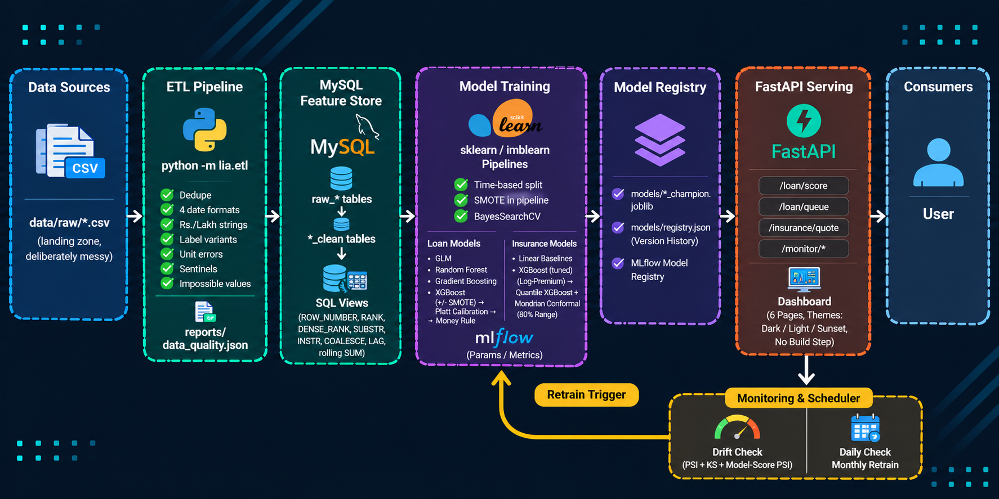

# CreditSure – Automated Loan and Insurance Risk Intelligence System

### Loan Eligibility Prediction and Insurance Pricing Forecast using Gradient Boosting and XGBoost on GCP with MySQL

## 1. What is this project

One web app, two modules:

* **Loan eligibility**: decides whether an applicant is *Eligible*, needs *Manual review* or is *Not eligible*, and explains why with SHAP reason codes.
* **Insurance pricing**: predicts an individual's annual health premium with an 80% error range. This is premium **prediction**; a monthly written-premium series for forecasting is also available as a SQL view.

> **Data disclosure.** The data is a **synthetic dataset seeded from public datasets** (Kaggle). It is not real customer data and contains no employer material. See [`docs/DATA_CARD.md`](docs/DATA_CARD.md).

## 2. Tech stack & architecture

* **Data & features:** MySQL feature store, SQL views (window functions)
* **Modeling:** scikit-learn / imbalanced-learn pipelines, SMOTE, BayesSearchCV, GLM, Random Forest, Gradient Boosting, XGBoost
* **Explainability:** SHAP reason codes
* **Experiment tracking:** MLflow (SQLite-backed, no extra container)
* **Serving:** FastAPI, Docker
* **Frontend:** static HTML/CSS/JS dashboard, no build step, Dark/Light/Sunset themes
* **Ops:** drift monitoring (PSI/KS), scheduled champion/challenger retrain



## 3. Results

Time-based split: train to Jan 2026, validate Feb-Jul 2026, test Aug-Oct 2026 (the drift period).

**Loan: fair comparison.** All models use the same features, preprocessing, split and calibration. The threshold is chosen on validation only.

| Model | Val ROC-AUC | Val MCC | Test ROC-AUC | Test MCC (val threshold) | Test value, break-even rule (Rs cr) |
|---|---|---|---|---|---|
| **Logistic regression (GLM), no SMOTE** - champion | **0.859** | **0.524** | **0.862** | **0.543** | **5.00** |
| Logistic regression (GLM) + SMOTE | 0.858 | 0.517 | 0.857 | 0.525 | 4.83 |
| XGBoost (tuned, BayesSearchCV) | 0.862 | 0.528 | 0.862 | 0.521 | 4.11 |
| Gradient boosting + SMOTE | 0.859 | 0.517 | 0.863 | 0.549 | 3.97 |
| XGBoost + SMOTE | 0.855 | 0.519 | 0.845 | 0.536 | 3.73 |
| XGBoost, no SMOTE | 0.860 | 0.525 | 0.855 | 0.481 | 3.62 |
| Random forest + SMOTE | 0.848 | 0.499 | 0.845 | 0.493 | 3.46 |

Approving every application in the test window would lose Rs 0.06 crore.

How to read the table:

* All models are within about 0.02 AUC of each other - **the GLM is a strong baseline**, not a weak one to beat for show.
* The champion rule picks whichever model is within 2% of the best validation business value, then breaks ties on validation AUC. In this retrain, only the two GLM rows land inside that 2% band (XGBoost tuned and GBM, which won the tie-break in an earlier retrain cycle, fell outside it this time) - **"Logistic regression (GLM), no SMOTE" is the honest champion**, not a runner-up promoted for a good story. That the ranking moved between retrains, purely from a MySQL-sourced refresh of the same generator's data, is itself a real finding: it's why the project has a champion/challenger retrain job and a registry history instead of a model frozen at first training.
* SMOTE does not help here. The positive rate is 18%, so the imbalance is mild, and SMOTE distorts probabilities, which is why every model is Platt-calibrated.
* **Decision rule:** approve while the predicted PD is below the loan's break-even PD. Break-even PD is margin / (margin + loss), so it depends on the loan's amount, rate and tenure. This beat a single global threshold on validation. Applications within ±30% of the threshold go to manual review.
* Hard policy rules (FOIR above 85%, age at maturity above 70) apply before the model.
* Gender and marital status are cleaned but **never used** as inputs, and the API doesn't accept them.

**Insurance (Health segment), test Aug-Oct 2026:**

| Model | RMSE (Rs) | MAE (Rs) | R² |
|---|---|---|---|
| Linear regression (raw target), best linear baseline | 11,026 | 5,900 | 0.696 |
| Linear regression (log target) | 11,640 | 5,284 | 0.662 |
| XGBoost (raw target) | 8,307 | 4,225 | 0.828 |
| XGBoost (log target) | 8,195 | 3,338 | 0.832 |
| **XGBoost (log target, tuned), champion** | **8,382** | **3,260** | **0.825** |

* RMSE is **24% lower than the linear baseline** (selected on validation RMSE: Rs 6,521 tuned vs Rs 6,588 for the untuned log-target model).
* **A validation-vs-test nuance, reported rather than hidden:** on the test/drift window, the untuned log-target XGBoost actually generalizes slightly better (RMSE Rs 8,195 vs the tuned champion's Rs 8,382) even though tuning won on validation. With only ~700 policies in the test window, that's a small, plausible validation-selection gap, not a bug - and a genuine "how do you know your tuning didn't overfit the validation set" interview answer.
* The gain over the linear baseline comes from the smoker × BMI interaction, which a linear model can't represent.
* The 80% error range covers 82% of test premiums: 84% for non-smokers but only 73% for smokers, where data is scarce and noisier. This is known and reported.

**Experiment tracking: MLflow.** Every candidate in both comparisons above is logged as its own MLflow run (params, metrics, fit time), with the two production champions registered in the MLflow Model Registry (`loan-champion`, `insurance-champion-point`) alongside `models/registry.json`. One deliberate choice worth explaining: this runs as a plain `sqlite:///...` tracking URI written directly by the training process, not a long-lived `mlflow server` container. MLflow 3.x's server starts several worker processes plus background job schedulers (trace archival, issue detection) meant for a shared team deployment - unnecessary weight, and a stability risk, for a single-user, zero-cost local project that has already hit Docker disk limits once (see the Quick start notes below). SQLite gives the same runs, params, metrics and Model Registry with nothing to keep alive; `mlflow ui` (not `mlflow server`) is the lightweight, on-demand viewer, run only when someone wants to look (`make mlflow-ui`).

**Monitoring.** Comparing the reference window with Aug-Oct 2026: interest-rate PSI is 0.15 and channel mix PSI is 0.12 (*watch*), and the default rate rose from 17.9% to 23.0%. The control period has PSI 0.005. The retrain job promotes a challenger only if it beats the champion on the latest labelled window; every decision is logged in `models/registry.json`.

## 4. Repository map

| Path | What |
|---|---|
| `src/lia/cleaning/` | deterministic row-level cleaning. Imputation lives in the pipelines, so it is fitted on train only |
| `src/lia/features.py` | FOIR, LTV, loan-to-income, assets; protected attributes excluded |
| `src/lia/loan_train.py`, `insurance_train.py` | comparison, tuning, calibration, intervals, plots |
| `src/lia/tracking.py` | fail-soft MLflow wrapper: every candidate logged, champions registered |
| `src/lia/metrics.py` | ROC-AUC, MCC, the money-based approval rule |
| `src/lia/drift.py`, `retrain.py`, `scheduler.py` | PSI/KS monitoring, champion/challenger, scheduler |
| `src/lia/api.py` | FastAPI service: decision, reason codes, what-if amount, queue, quotes, monitoring - and serves `web/` |
| `web/` | Dashboard: static HTML/CSS/JS, no build step - `index.html` (shell), `css/app.css` (Dark/Light/Sunset themes), `js/` (API client, charts, 6 pages) |
| `sql/` | DDL (generated by `scripts/gen_ddl.py`) and analytics views |
| `reports/` | comparison tables, figures, drift reports, data-quality report |
| `tests/` | 22 tests: cleaning, metrics, drift, SQL views (on SQLite), API contract |

## 5. Quick start (free, local)

```bash
cp .env.example .env            # set your own passwords
docker compose up --build       # mysql -> bootstrap (load, clean, train, drift) -> api + scheduler
# dashboard + API: http://localhost:8001   (interactive API docs at http://localhost:8001/docs)
```

Host ports (3306 MySQL, 8001 API/dashboard, 5000 MLflow UI) are overridable - if one is already taken by
another project on your machine, set `MYSQL_PORT` / `API_PORT` / `MLFLOW_UI_PORT` in `.env` instead of
editing `docker-compose.yml`.

Without Docker:

```bash
pip install -r requirements-dev.txt
export PYTHONPATH=src
python -m lia.etl                 # raw -> data/processed/*.parquet
python -m lia.loan_train          # ~1-2 min on a laptop
python -m lia.insurance_train
python -m lia.drift --kind loan --current new
uvicorn lia.api:app --port 8000   # dashboard + API: http://localhost:8000
pytest -q
```

Every training run (loan and insurance) is logged to MLflow automatically - no setup needed, no extra container running by default. To browse it:

```bash
docker compose --profile tools run --rm --service-ports mlflow-ui     # or: make mlflow-ui
# http://localhost:5000
```

## 6. Limitations (stated up front)

1. Synthetic data. The default outcome comes from a documented generator, so AUC measures the pipeline, not real credit risk.
2. The money rule uses assumptions in `config.py` (cost of funds 7.5%, EAD 65%, recoveries estimated from history).
3. SMOTE is applied after one-hot encoding. SMOTENC would be the purist choice for mixed data.
4. The SQL views are tested on SQLite with shims for `STR_TO_DATE`/`DATEDIFF`, and on MySQL through `docker compose`.
5. MLflow uses a local SQLite backend by design, not a shared tracking server (see **Experiment tracking: MLflow** above) - fine for one person's laptop, not for a team sharing experiment history.

See [`docs/GCP_MAPPING.md`](docs/GCP_MAPPING.md) for how this maps to GCP.
